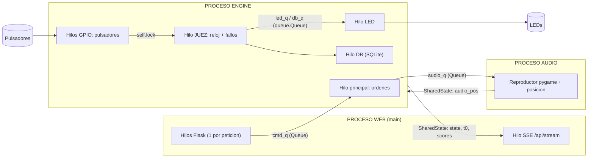

# Arquitectura: procesos, hilos y variables compartidas
*(Base para el documento de 1-2 paginas de la entrega. Sustituir por el diagrama final.)*

## Procesos
| Proceso | Para que | Por que separado |
|---|---|---|
| WEB (main) | Flask, SSE, API | Atender navegadores sin afectar al juego |
| ENGINE | Logica, E/S fisica, persistencia | Aislar la latencia de pulsaciones del trafico web |
| AUDIO | Musica y reloj de audio | La salida de audio no compite por el GIL |

## Hilos (proceso ENGINE)
principal (ordenes) · JUEZ (reloj, fallos, fin) · GPIO (callbacks gpiozero) · LED · DB

## Variables compartidas
| Variable | Entre | Mecanismo | Proteccion |
|---|---|---|---|
| state, t0, score/combo/perfect/good/miss/last | ENGINE -> WEB | `multiprocessing.Value/Array` | `shared.lock` |
| audio_pos | AUDIO -> ENGINE/WEB | `Value('d')` | un solo escritor |
| stop_event | MAIN -> todos | `multiprocessing.Event` | atomico |
| ordenes start/stop/press | WEB -> ENGINE | `multiprocessing.Queue` | interna |
| play/stop | ENGINE -> AUDIO | `multiprocessing.Queue` | interna |
| next_note, chart | hilos de ENGINE | atributos de `Engine` | `Engine.lock` |
| led_q, db_q | hilos de ENGINE | `queue.Queue` | interna |

Reloj comun: `time.monotonic()` (comparable entre procesos en Linux).
